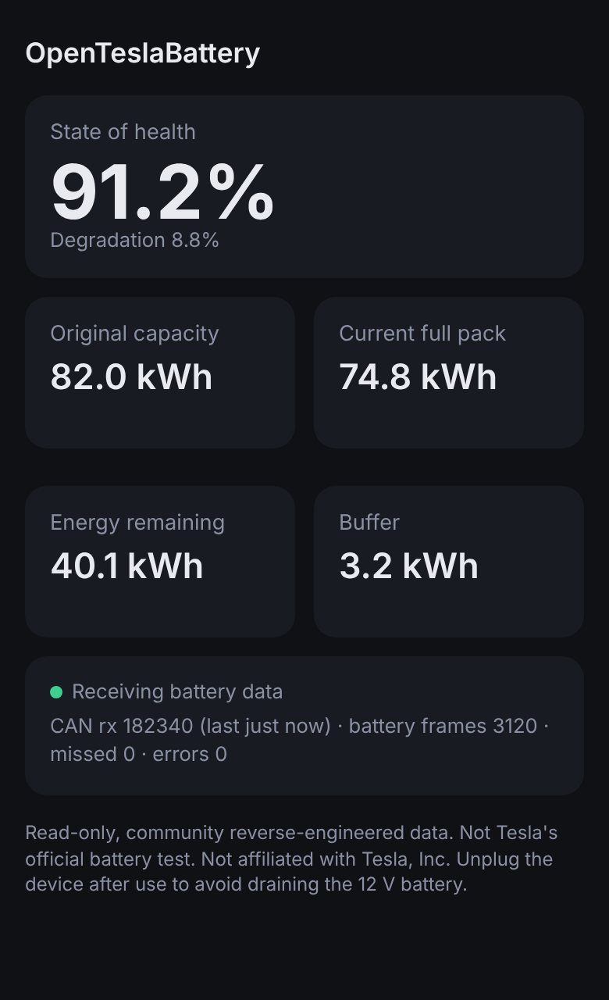

# OpenTeslaBatteryESP

**Check your Tesla Model 3/Y battery health with a cheap ESP32.** Listen-only, no app, no cloud, open source.

[](https://github.com/lapht/OpenTeslaBatteryESP/actions/workflows/build.yml)
[](LICENSE)
[](docs/validation.md)
[](https://lapht.github.io/OpenTeslaBatteryESP/)

<p align="center"><br><sub>The page served by the device. Demo data, not from a real car.</sub></p>

**Site and browser flashing:** https://lapht.github.io/OpenTeslaBatteryESP/

Open-source, **read-only** ESP32 firmware that listens to a Tesla's CAN bus, decodes the battery management system (BMS) frames and shows **battery health** (state of health, degradation, capacity) on a web page served by the ESP itself. Connect your phone to the ESP's WiFi and open the page. No app, no cloud, no Tesla account, and nothing is ever written to the bus.

> **Status: early development.** The firmware skeleton builds and the decoders have unit tests, but **nothing has been validated on a real car yet**. Do not trust the numbers until the [MVP milestone](https://github.com/lapht/OpenTeslaBatteryESP/milestones) is closed.

## Why

Commercial "Tesla boxes" cost hundreds of euros and promise unlocks that mostly don't work on current firmware. This project does one useful, legal and verifiable thing: it reads what the BMS already reports about your battery, using a ~15 € bill of materials.

## Features

| | Status |
|---|---|
| TWAI listen-only at 500 kbit/s (no TX, no ACK) | implemented, untested on car |
| Decode 0x292 (beginning-of-life energy) and 0x352 (nominal full pack energy) | implemented, untested on car |
| SOH and degradation | implemented |
| WiFi SoftAP + mobile web page + `/api/status` JSON | implemented |
| Friendly URL `http://tesla.lan/`, captive portal, mDNS `tesla.local` | implemented, untested on device |
| Serial CAN sniffer + log summary tool | implemented |
| Brick voltages, spread, range, cycles, live charts | planned (v0.2) |
| Deep sleep, history | planned (v0.4) |
| Project site with browser flashing (ESP Web Tools) | implemented, live after the first release |
| Model Y | planned (v1.0) |

## How it works

```
Model 3 diagnostic port ──► CAN-H / CAN-L ──► SN65HVD230 ──► ESP32 TWAI (listen-only, 500k)
                                                                  │
                                                  decode BMS frames → compute SOH
                                                                  │
                                              WiFi SoftAP ──► async web server ──► phone
```

Details in [docs/architecture.md](docs/architecture.md).

## Hardware

- ESP32 DevKitC (classic) or ESP32-C6 DevKitC-1
- SN65HVD230 CAN transceiver module (3.3 V)
- OBD-II male plug with open wires (EU Model 3/Y 2019+ have an OBD-II port in the driver footwell)
- 12 V → 5 V supply or USB power bank
- Optional: Model 3/Y center console adapter (only if the OBD-II port does not carry the battery frames)

See [docs/hardware.md](docs/hardware.md) and [docs/wiring.md](docs/wiring.md).

## Quick start

```bash
pip install platformio
git clone https://github.com/lapht/OpenTeslaBatteryESP.git
cd OpenTeslaBatteryESP
pio run -e esp32dev -t upload      # firmware
pio run -e esp32dev -t uploadfs    # web page (LittleFS)
pio device monitor
```

Then join the WiFi network `OpenTeslaBattery-XXXX` (default password `teslabattery`, set your own with `OTB_AP_PASSWORD` at build time) and open **`http://tesla.lan/`** (or `http://192.168.4.1/`). Most phones open the page on their own as a "sign in to network" screen. See [docs/web-access.md](docs/web-access.md).

Full guide: [docs/getting-started.md](docs/getting-started.md).

## Documentation

- [Getting started](docs/getting-started.md): build, flash, first connection
- [Hardware](docs/hardware.md): bill of materials
- [Wiring](docs/wiring.md): transceiver and diagnostic port
- [Web access](docs/web-access.md): `tesla.lan`, captive portal, mDNS
- [Architecture](docs/architecture.md): firmware design
- [CAN mapping](docs/can-mapping.md): decoded signals and their sources
- [Battery health](docs/battery-health.md): formulas and limitations
- [Validation](docs/validation.md): how values are checked on real cars
- [Safety and legal](docs/safety-and-legal.md)
- [Roadmap](docs/roadmap.md)

## Ground rule: read-only

The firmware runs the CAN controller in listen-only mode. It never transmits a frame, an ACK bit or an error frame, and there is no code path to do so. Pull requests that add any form of transmission will not be merged. See [CONTRIBUTING.md](CONTRIBUTING.md).

## Disclaimer

This is an independent project, not affiliated with or endorsed by Tesla, Inc. Tesla, Model 3, Model Y, Model S and Model X are trademarks of Tesla, Inc. Signal definitions come from community reverse engineering, and the values shown are **not** an official Tesla diagnosis. Use at your own risk, and unplug the device after use so it does not keep the car awake and drain the 12 V battery. See [docs/safety-and-legal.md](docs/safety-and-legal.md).

## Help wanted

Have a Model 3 or Model Y and 20 € of parts? The most useful contribution right now is a [car validation report](https://github.com/lapht/OpenTeslaBatteryESP/issues/new?template=car_validation.yml): model, year and the values shown next to Scan My Tesla. Code contributions: see issues labelled [`good first issue`](https://github.com/lapht/OpenTeslaBatteryESP/labels/good%20first%20issue) and [`help wanted`](https://github.com/lapht/OpenTeslaBatteryESP/labels/help%20wanted), and [CONTRIBUTING.md](CONTRIBUTING.md).

If the project is useful to you, a ⭐ on GitHub helps other owners find it.

## Credits

- [joshwardell/model3dbc](https://github.com/joshwardell/model3dbc): DBC signal definitions
- [ErikHakobyan/OpenTeslaBuyer](https://github.com/ErikHakobyan/OpenTeslaBuyer): read-only approach and health formulas (concept reference)
- [commaai/opendbc](https://github.com/commaai/opendbc), [onyx-m2/onyx-m2-dbc](https://github.com/onyx-m2/onyx-m2-dbc): cross-check DBCs

## License

[MIT](LICENSE)
