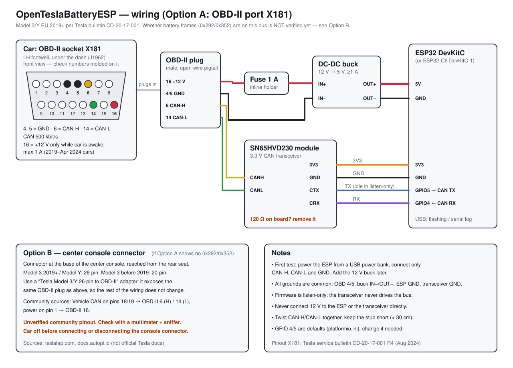

# Wiring

> Nothing on the car side has been tested by this project yet. The OBD-II port pinout comes from an official Tesla document; whether the battery frames are present on that port is **unknown** until someone sniffs it (issue #3).

## Where to connect on a Model 3 / Model Y

There are two candidate connection points.

### Option A: OBD-II port X181 (try this first)

Tesla service bulletin [CD-20-17-001](https://service.tesla.com/docs/ServiceBulletins/External/CD/CD-20-17-001_Model_3Y_Third-Party_CAN_Bus_Interface_R4.pdf) ("Model 3/Y Third-Party CAN Bus Interface", R4, August 2024) says that Model 3 and Model Y for Europe and Asia Pacific (except Korea and Taiwan) have a standard SAE J1962 OBD-II socket, **X181**, under the left side of the dashboard (LH footwell; on some cars behind the footwell cover). It applies to:

- Model 3 with VIN starting 5YJ produced from 5 Jan 2019, or LRW from 18 Oct 2019, and all 2024+ Model 3
- Model Y with VIN starting 5YJ from 13 Jan 2021, LRW from 14 Dec 2020, 7SA / XP7 from start of production

Pinout from the bulletin:

| OBD-II pin | Signal |
|---|---|
| 4, 5 | Ground |
| 6 | CAN high, 500 kbit/s |
| 14 | CAN low, 500 kbit/s |
| 16 | +12 V "accessory feed", only while the car is awake. 1 A max (2017–2023 Model 3, Model Y before Apr 2024), 4 A on newer cars |
| 3, 11 | +12 V on pre-April-2024 cars; Tesla says this will be disabled by a software update. **Do not use.** |

Open question: this is a "third-party CAN bus interface". Tesla does not say which messages it carries, so it may be a filtered subset of Vehicle CAN. If 0x292 and 0x352 do not show up here, use Option B.

### Option B: center console diagnostic connector

The diagnostic connector at the base of the center console (reached from the rear seat) carries the full vehicle buses. Community sources ([teslatap.com](https://teslatap.com/modifications/extracting-internal-vehicle-data/), [AutoPi](https://docs.autopi.io/hardware/accessories/tesla-obd2-adapter-model-3-y/)) report:

- Model 3 from 2019 and Model Y: **26-pin** connector. Model 3 before 2019: **20-pin**.
- Vehicle CAN on connector pins 19 (CAN-H) and 18 (CAN-L), mapped by the usual adapters to OBD-II pins 6 and 14. Power on pin 1, mapped to OBD-II pin 16.

These are **not official Tesla documents**: verify with a multimeter and the sniffer before trusting them. Switch the car off before plugging or unplugging this connector.

With a "26-pin to OBD-II" adapter the car side looks like Option A, so the rest of the wiring is the same.

## ESP32 ↔ SN65HVD230

| SN65HVD230 module | ESP32 DevKitC | ESP32-C6 DevKitC-1 |
|---|---|---|
| 3V3 | 3V3 | 3V3 |
| GND | GND | GND |
| CTX / D (TX) | GPIO 5 (`OTB_CAN_TX_PIN`) | GPIO 5 (`OTB_CAN_TX_PIN`) |
| CRX / R (RX) | GPIO 4 (`OTB_CAN_RX_PIN`) | GPIO 4 (`OTB_CAN_RX_PIN`) |
| CANH | OBD-II pin 6 | |
| CANL | OBD-II pin 14 | |

The GPIOs are defaults set in `platformio.ini` and can be changed. The TX line is wired because the TWAI driver requires a TX pin, but in listen-only mode the controller never drives the bus.

**Termination:** many SN65HVD230 modules have an onboard 120 Ω resistor. The car's bus is already terminated at both ends; remove the extra resistor.

**Cable:** twist CAN-H and CAN-L together and keep the stub from the OBD plug to the transceiver short (under ~30 cm).

## Power

| Stage | Wiring |
|---|---|
| First test | ESP32 powered by a USB power bank. From the car connect only CAN-H, CAN-L and GND (OBD-II 4 or 5). |
| Permanent | OBD-II pin 16 → 1 A fuse → 12→5 V buck IN+; OBD-II pin 4/5 → buck IN−; buck OUT+ → ESP32 5V; buck OUT− → ESP32 GND. Optional TVS diode across the buck input. |

All grounds are common. Never connect 12 V to the ESP32 or the transceiver directly. Don't power the ESP from USB (laptop) and the buck at the same time.

## Checking you are on the right bus

1. Build with `-DOTB_SERIAL_SNIFFER=1` and flash.
2. Capture: `pio device monitor | tee capture.log` for ~30 seconds with the car awake.
3. Run `python3 tools/can_log_summary.py capture.log`.
4. If 0x292 and 0x352 are missing, you are on the wrong bus or pins. This is the most common failure.

If `rx` stays at 0 and `buserr` grows, check CAN-H/CAN-L polarity and the bitrate.
